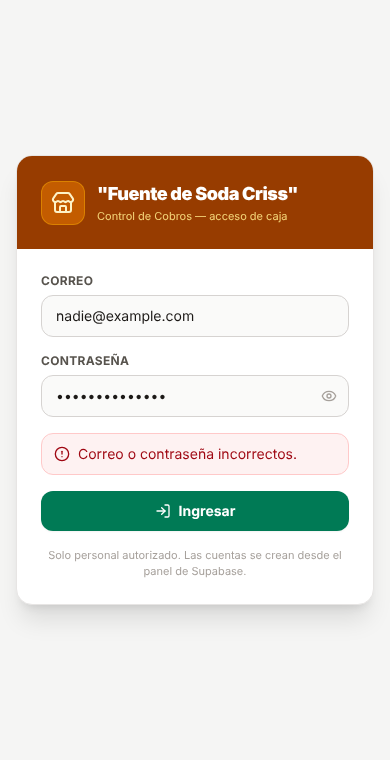
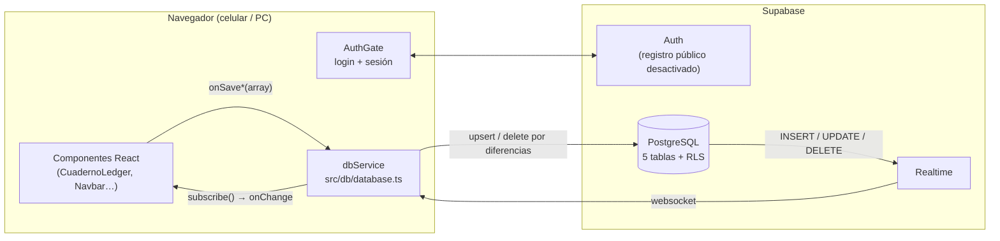

# 🥤 Fuente de Soda Criss — Control de Ventas y Cobros

Aplicación web para gestionar el día a día de una fuente de soda real en Lima: pedidos de almuerzo por piso, **cuentas diarias y semanales** de los comerciantes del edificio, cobros de la **mesa del salón**, abonos en **efectivo o Yape** y respaldo en Excel/JSON.

Varias personas pueden usarla a la vez desde el celular o la computadora: **cada cambio se guarda en la nube y aparece al instante en todas las pantallas abiertas.**

<p align="center">
  
</p>

## ✨ Funcionalidades

- **Registro de pedidos** por cliente y piso (Calle, 1ro–4to), con menú completo o solo segundo y adicionales del catálogo.
- **Cuentas diarias y semanales**: saldo por cobrar, abonos parciales, marcar como pagado (efectivo / Yape). Un pedido va siempre a la cuenta que tiene el cliente.
- **Lonches**: tablero de la tarde con tres fases (anotado → preparado → listo) y la hora de cada paso; el pedido se suma a la cuenta del cliente y los listos se separan en cobrados / no cobrados.
- **Estado de cuenta por WhatsApp**: máximo 2 semanas detalladas (lunes a sábado), lo anterior resumido en "cuenta pasada".
- **Mesa del salón**: contador de menús y extras del día, con cuadre efectivo vs. Yape.
- **Directorio de clientes**: alta, edición, fusión de duplicados y eliminación.
- **Catálogo de adicionales** editable (bebidas, panes, dulces…), con filtro por tipo y opción para combinar duplicados sin alterar montos ya cobrados.
- **Respaldo**: descarga ZIP (Excel/CSV + JSON) y restauración completa.
- **Multiusuario en tiempo real** con inicio de sesión.

## 🧱 Stack

| Capa | Tecnología |
|---|---|
| Frontend | React 19 · TypeScript · Vite · Tailwind CSS 4 · lucide-react |
| Backend (BaaS) | Supabase: PostgreSQL · Auth · Realtime |
| Hosting | Vercel |

## 🏗️ Arquitectura



### Cómo sincroniza `dbService`

Los componentes siguen trabajando con arreglos completos (`saveConsumptions(todos)`), pero la capa de datos solo envía lo necesario:

- **Diff a 3 vías**: compara lo que el usuario guarda con lo que *su pantalla* tenía. Sube solo lo que él creó o editó y borra solo lo que él quitó, así una copia vieja nunca pisa el cambio de otra persona.
- **Cola global**: los guardados se aplican en orden (p. ej. cliente nuevo → su pedido), respetando la clave foránea.
- **Tiempo real**: los cambios de otras pantallas llegan por Supabase Realtime; al reconectar o volver a la pestaña se resincroniza.
- **Tolerancia a fallos**: si un guardado falla, se avisa y se reintenta automáticamente.
- **Importación atómica**: restaurar un respaldo ejecuta la función `import_backup(jsonb)` en una sola transacción (todo o nada).

## 🗄️ Modelo de datos

| Tabla | Entidad (`src/types.ts`) | Notas |
|---|---|---|
| `clients` | `ClientRecord` | cuenta `semanal` / `diaria` |
| `consumptions` | `ConsumptionRecord` | FK → `clients`; almuerzos y extras como JSONB (foto del precio al momento de la venta); `lonche` JSONB con la fase y sus horas |
| `payments` | `PaymentRecord` | abonos, FK → `clients` |
| `mesa_records` | `MesaCounterRecord` | un registro por día (`UNIQUE(date)`) |
| `extras` | `ExtraItem` | catálogo de adicionales |

Esquema completo e idempotente en [`supabase/schema.sql`](supabase/schema.sql). Detalle de la migración desde IndexedDB en [`supabase/README.md`](supabase/README.md).

## 🔐 Seguridad

- **Row Level Security** en todas las tablas: sin sesión no se puede leer ni escribir nada.
- **Registro público desactivado**: las cuentas se crean solo desde el panel de Supabase.
- La clave que usa el frontend es la **publishable/anon** (pública por diseño); la seguridad real la dan las políticas RLS. Las credenciales viven en `.env.local`, que no se versiona.

## 🚀 Puesta en marcha local

Requisitos: Node.js 20+ y un proyecto de Supabase.

```bash
npm install
cp .env.example .env.local        # completa VITE_SUPABASE_URL y VITE_SUPABASE_ANON_KEY
npm run dev                       # http://localhost:3000
```

En Supabase:

1. **SQL Editor** → ejecuta `supabase/schema.sql`.
2. **Authentication → Sign In / Providers** → desactiva *Allow new users to sign up*.
3. **Authentication → Users → Add user** → crea el usuario de caja (con *Auto confirm*).

## ☁️ Despliegue (Vercel)

1. Importa este repositorio en Vercel (detecta Vite automáticamente: `npm run build` → `dist/`).
2. En **Environment Variables** agrega `VITE_SUPABASE_URL` y `VITE_SUPABASE_ANON_KEY`.
3. Deploy. Cada `git push` a `main` vuelve a publicar.

## 📁 Estructura

```
src/
├── components/          UI (CuadernoLedger, LonchesBoard, Navbar, modales) + AuthGate (login)
├── db/
│   ├── database.ts      dbService: mapeo, diff, cola, tiempo real
│   └── backupParser.ts  lectura/normalización de respaldos JSON
├── lib/supabase.ts      cliente de Supabase
├── utils/               fechas, precios, teléfonos, estado de cuenta, exportación ZIP
├── data/                catálogo inicial y datos de demostración
└── types.ts             modelo de dominio
supabase/
├── schema.sql           tablas, RLS, realtime, import_backup()
└── README.md            bitácora de la migración
```

## 🗺️ Próximos pasos

- [ ] Correo del usuario y botón de salir dentro del Navbar.
- [ ] Confirmación antes de restaurar un respaldo (reemplaza la nube para todos).
- [ ] Reportes: ventas por día/semana y platos más pedidos (consultas SQL / vistas).
- [ ] Backend propio con **Spring Boot + PostgreSQL** (las clases Java de dominio ya están esbozadas en `src/data/javaCode.ts`).

---

Desarrollado por **Paolo**.
